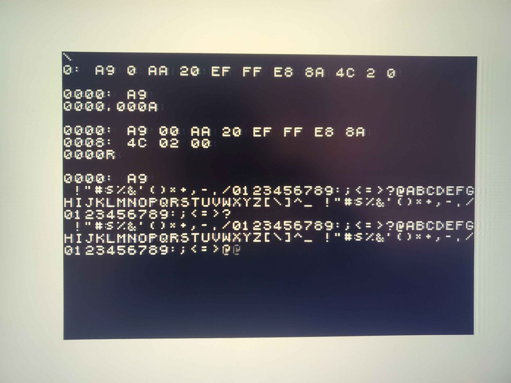
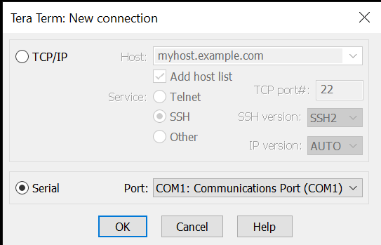

# CPE 487 Final Project: Apple-I

## Project Overview

The goal of this project was to create a (somewhat) faithful recreation of the Apple I computer in
VHDL for use on the Nexys-A7 FPGA board. The project closely emulates the original hardware
of the Apple I, modeling its proprietary shift-register based display circuitry for output through
the VGA port as well the Motorola 6821 peripheral interface adapter that allows simultaneous
connection of a keyboard and a monitor to the 6502 CPU.

Apple I Overview:

- Simple MOS-6502 based machine with dedicated video circuitry
- Utilized 256 bytes of ROM to store a lightweight hex monitor / operating system (Wozmon)
- Shipped with 4K of user-accessible RAM
- Utilized the Motorola 6821 Peripheral Interface Adapter to bridge the gap between the keyboard + display circuitry
- Display circuitry consisted of 7 x 1024-bit shift registers

Our Implemntation:

- Built upon a premade 6502 CPU core from https://github.com/Steve-Teal/mx65
- Utilized vga_sync module from Lab 6 for display timing (along with associated clk_wiz modules)
- Utilized UART protocol to serially transfer ASCII data from computer to Nexys-A7 board along with custom UART receiver module
- Closely modeled behavior of the Apple I display circuitry + adjusted to interface with VGA protocol
- Closely modeled behavior of the 6821 Peripheral Interface Adapter
- Created a 4K RAM module to interface with the 6502 CPU


## Required Hardware

- **Digilent Nexys A7 FPGA Board**

  

- **VGA Monitor** (800×600 @ 60 Hz)

    

- **VGA to HDMI Cable**

    

- **USB Cable** (programming and power)

    

## Expected Behavior

### Required Attachments

- VGA cable or VGA → HDMI adapter (depending on your monitor)
- Either a VGA‑compatible or HDMI‑compatible monitor
- A laptop or keyboard
- An application to send serial data to the Nexys‑A7 board (such as **Tera Term**)

### System Operation

- The Apple I VHDL implementation operates near‑identically to the original Apple I from 1967.
- To ensure a clean slate upon first startup, **SW 1** and **SW 0** on the Nexys‑A7 board can be toggled to clear the screen and reset the system, respectively.
- Typing in **Tera Term** should send data to the Apple I and ultimately to the display.
- The implementation supports all original **Wozmon** commands from the base Apple I.

### Basic Wozmon Commands

_(XXXX and YYYY represent hexadecimal values of up to 4 bytes)_

| Command            | Function                          |
| ------------------ | --------------------------------- |
| `XXXX`             | Examine contents at address       |
| `XXXX.YYYY`        | Examine contents in address range |
| `XXXX: YY YY YY …` | Edit contents starting at address |
| `XXXXR`            | Run program starting at address   |



_An example of writing, reading, and running a program in Wozmon_

- Display should automatically scroll upwards once text reaches the bottom of the screen.

- Wozmon will process and run any **6502 machine code programs** that are written at a memory location in the available **4 KB of RAM**.
- Essentially, any program that can fit within 4 KB of RAM and can be written in 6502 machine code can be run on our Apple I implementation.
- Some example programs:
  - **Apple I Manual Test Program:** Prints all 64 ASCII characters available to the Apple I in a row, then prints a carriage return (CR).
    - _Machine Code listing at $0000:_  
      `A9 00 AA 20 EF FF E8 8A 4C 02 00`
  - **Our Own Test Program:** Prints the ASCII string located at memory location $0100 and terminated with character #$00.
    - _Machine Code listing at $0000:_  
      `A9 0D 20 EF FF A2 00 BD 00 01 C9 00 F0 07 20 EF FF EB 18 90 F2 A9 0D 20 EF FF 4C 1F FF`

## System Configuration & Instructions

### Vivado Setup & Programming Instructions

1. **Download all source files** (`.vhd`) and the constraint file (`.xdc`) from this repository.
2. **Create a new Vivado project** targeting the **Digilent Nexys A7‑100T FPGA board**.
3. **Add Source Files**  
   Include the following VHDL modules:
   - `apple_i_top.vhd` (top‑level design)
   - `clk_wiz_0.vhd` and `clk_wiz_0_clk_wiz.vhd` (clock generation)
   - `display_top.vhd`, `vga_sync.vhd`, `pixel_decode.vhd`, `line_buffer.vhd` (video pipeline)
   - `ram.vhd`, `rom.vhd`, `font_rom_pkg.vhd` (memory components)
   - `io_top.vhd`, `uart_protocol.vhd`, `shiftregister.vhd`, `6821_core.vhd`, `mx65.vhd` (I/O and peripheral logic)
4. **Add Constraints File**
   - Use `apple_i_top.xdc` for pin assignments and board‑specific mappings.
5. **Run Synthesis**
   - Verify that all modules compile successfully and resolve dependencies.
6. **Run Implementation**
   - Check timing reports and ensure all constraints are met.
7. **Generate Bitstream**
   - Wait for Vivado to complete bitstream generation (`.bit` file).
8. **Program the Device**
   - Open **Hardware Manager**, connect the Nexys A7 board via USB, and program it with the generated bitstream.
9. **Verify Operation**
   - Confirm VGA output and UART communication are functioning as expected.

---

### Tera Term Setup

- **Download the latest Tera Term installer** from:  
  [https://github.com/TeraTermProject/teraterm/releases](https://github.com/TeraTermProject/teraterm/releases)
- Follow the steps in the installation wizard.
- Open **Tera Term** and select **Serial connection**, setting it to the COM port that matches your Nexys A7 board.



- Go to **Setup → Serial Port** and configure:
  - Speed = 9600
  - Data = 8 bit
  - Parity = None
  - Stop Bits = 1 bit
  - Flow control = NONE
- You should now be able to send serial data to the board.

---

### VGA Setup

- **If using an HDMI monitor:**  
  Connect the VGA‑to‑HDMI adapter to the VGA port on the Nexys A7 board.  
  Then connect the HDMI cable from your monitor to the adapter, and plug the adapter’s USB cable into the board’s USB Host port.
- **If using a VGA monitor:**  
  Connect a VGA cable directly from your monitor to the board’s VGA port.

## FPGA Inputs & Outputs
- Main inputs / outputs of the Apple I are the keyboard and the display
- 2 extra inputs for our project: SW1 and SW0 on the Nexys A7 board
  - Used for screen clear and system reset on toggle, respectively
  - Implemented in top level file apple_i_top.vhd
    - ```
      ##Switches
      set_property -dict { PACKAGE_PIN J15   IOSTANDARD LVCMOS33 } [get_ports { RESET }]; #IO_L24N_T3_RS0_15 Sch=sw[0]
      set_property -dict { PACKAGE_PIN L16   IOSTANDARD LVCMOS33 } [get_ports { CLR_SCREEN }]; #IO_L3N_T0_DQS_EMCCLK_14 Sch=sw[1]
      ```
- UART input comes from TeraTerm on the user’s computer
  - Serial data sent over COM port
  - Received using custom UART receiver module
  - Txd port on board used as UART in port
  - ```
    ##USB-RS232 Interface
    set_property -dict { PACKAGE_PIN C4    IOSTANDARD LVCMOS33 } [get_ports { UART_IN }];     #IO_L7P_T1_AD6P_35 Sch=uart_txd_in
    ```
  - **Generalized UART packet description**
  - 
- VGA output pins used on board
  - Red, Green, and Blue output pins utilized (full-color spectrum, although we are only forcing the color to white)
  - Hsync and Vsync pins utilized to control display timing
  - ```
    set_property -dict { PACKAGE_PIN A3    IOSTANDARD LVCMOS33 } [get_ports { RED_OUT[0] }]; #IO_L8N_T1_AD14N_35 Sch=vga_r[0]
    set_property -dict { PACKAGE_PIN B4    IOSTANDARD LVCMOS33 } [get_ports { RED_OUT[1] }]; #IO_L7N_T1_AD6N_35 Sch=vga_r[1]
    set_property -dict { PACKAGE_PIN C5    IOSTANDARD LVCMOS33 } [get_ports { RED_OUT[2] }]; #IO_L1N_T0_AD4N_35 Sch=vga_r[2]

    set_property -dict { PACKAGE_PIN C6    IOSTANDARD LVCMOS33 } [get_ports { GREEN_OUT[0] }]; #IO_L1P_T0_AD4P_35 Sch=vga_g[0]
    set_property -dict { PACKAGE_PIN A5    IOSTANDARD LVCMOS33 } [get_ports { GREEN_OUT[1] }]; #IO_L3N_T0_DQS_AD5N_35 Sch=vga_g[1]
    set_property -dict { PACKAGE_PIN B6    IOSTANDARD LVCMOS33 } [get_ports { GREEN_OUT[2] }]; #IO_L2N_T0_AD12N_35 Sch=vga_g[2]

    set_property -dict { PACKAGE_PIN B7    IOSTANDARD LVCMOS33 } [get_ports { BLUE_OUT[0] }]; #IO_L2P_T0_AD12P_35 Sch=vga_b[0]
    set_property -dict { PACKAGE_PIN C7    IOSTANDARD LVCMOS33 } [get_ports { BLUE_OUT[1] }]; #IO_L4N_T0_35 Sch=vga_b[1]

    set_property -dict { PACKAGE_PIN B11   IOSTANDARD LVCMOS33 } [get_ports { H_SYNC }]; #IO_L4P_T0_15 Sch=vga_hs
    set_property -dict { PACKAGE_PIN B12   IOSTANDARD LVCMOS33 } [get_ports { V_SYNC }]; #IO_L3N_T0_DQS_AD1N_15 Sch=vga_vs
    ```
- Clk_in used as our 100MHz system clock
  - ```
    ## Clock signal
    set_property -dict { PACKAGE_PIN E3    IOSTANDARD LVCMOS33 } [get_ports { CLK_IN }]; #IO_L12P_T1_MRCC_35 Sch=clk100mhz
    create_clock -add -name sys_clk_pin -period 10.00 -waveform {0 5} [get_ports {CLK_IN }];
    ```

## Modifications & Implemntation

### Non-modified / Base components

| Component                                                   | Source                                                | #scription                                                                                                                      |
| ----------------------------------------------------------- | ----------------------------------------------------- | ------------------------------------------------------------------------------------------------------------------------------- |
| **6502 CPU (`mx65.vhd`)**                                   | [Steve-Teal/mx65](https://github.com/Steve-Teal/mx65) | Complete 6502 processor core that we used as is, focusing on integration with memory and I/O.                                   |
| **Wozmon ROM (`rom.vhd`)**                                  | Apple-1 Manual (1976)                                 | The original monitor program written by Steve Wozniak. We translated the published hex dump into a VHDL ROM array               |
| **Clock Wizard (`clk_wiz_0.vhd`, `clk_wiz_0_clk_wiz.vhd`)** | CPE 487 Lab 6                                         | Xilinx MMCM configuration that converts the 100 MHz board clock to 108 MHz for VGA timing. Used exactly as provided in the lab. |

### **Modified / New Components**

### **Display Circuitry**

- Consists of several files tied together in display_top.vhd
  - Line buffer module, pixel decode module, vga sync module, clk wiz module, shift register module, font rom package
  - **Block-Diagram representation of display_top.vhd**
  - 
- Shift Register Module
  - The “core” of the Apple I display circuitry
  - Closely models the original hardware
  - 7 x 1024-bit shift registers modeled with a VHDL array:
  - ```
    type r_shift_t is array(1023 downto 0) of std_logic_vector(6 downto 0);
    signal r_shift : r_shift_t := (1023 => "0000000", others => "1000001");
    ```
  - The Apple I essentially operates by shifting each entry left an entire 1024 times per frame to ensure it is drawn at the same place on screen during each frame
  - Shifts happen during VGA blanking periods
    - During the first hblank of a new character row, the entire row is shifted left 40x but also copied into a line buffer for that row:
    - ```
      buf_we <= '0';
      if v_blank = '0' and burst_ptr <= 40 then
        buf_write_addr <= 40 - burst_ptr;
        if r_shift(1023)(0) = '0' then
          buf_write_data <= cursor_char;
        else
          buf_write_data <= r_shift(1023)(6 downto 1);
        end if;
        buf_we         <= '1';
      end if;
      ```
    - This line buffer is then sent to the pixel decode module to be processed
    - During vblank, we must shift an extra 64 times to account for the extra 64 characters of space in shift register memory (24 rows \* 40 columns is only 960 characters):
    - ```
      if v_blank = '1' and v_burst_done = '0' then
        burst_ptr <= 64;
        if scroll_pending = '1' then
          burst_ptr <= 64 + 40;
          state <= SCROLL;
          scroll_pending <= '0';
        end if;
        v_burst_done <= '1';
      ```
    - Notice that we shift an extra 40 times if scrolling to ensure that the entire screen gets pushed up by 1 row
- Line Buffer Module
  - Simply gets character rows shifted into it for every new character row reached on the screen
  - A new character row is reached in the drawing area every 16 scanlines (the height of a character cell)
  - Can be accessed by the pixel decode module and written to by the shift register module
- Pixel decode module
  - Does the main math to determine what to draw on the screen
  - Draws from font_rom_pkg.vhd bitmaps
  - Receives line buffer for the current line from line_buffer.vhd
  - 
  - Receives current pixel row, column being drawn by vga_sync and uses modulus math to determine what index in the line buffer we are in:
  - ```
    scanline   := (ipixel_row - 108) mod 16;
    vindex     := scanline / 2; --vertical index within character
    hindex     := ((ipixel_col - 120) mod 14) / 2; --horizontal within character
    char_col   := (ipixel_col - 120) / 14;
    ```
  - Pixel decoder will then draw from the font rom for that specific index within the character to determine whether the pixel should be on or not
- VGA_sync and clk_wiz function nearly identically to how they were used in previous labs
  - VGA_sync had two signals added, hblank and vblank, which go high when not in active row/vertical drawing space
  - Used for timing purposes within shiftregister.vhd
 
### **Peripheral Interface Adapter (PIA)**
- Model of the Motorola 6821 PIA
- Features control/data registers from address ``0xD010-0xD013``
  - Data registers hold input from keyboard / output before it is pushed to display
  - Control registers control the function of the PIA's inputs/outputs/interrupts
  - **General function of the control registers highlighted here**
  - 
- VHDL code attempts to closely model the functionality of the 6821 PIA
  - Code snippets would be too large to put here, but the PIA functions as a mix of combinational/synchronous logic
- Main functionality with data direction registers
  - Upon startup/reset, data registers are configured as data direction registers
  - Setting a bit of 1 anywhere in these 8-bit registers configures the bit as output, a 0 as input
  - Keyboard DDR set to all 0s (all inputs), display DDR set to all outputs except for MSB, used as signal to tell the PIA when it is ready to receive character data

### **UART**
- Custom UART receiver coded in VHDL
- Essentially acts as a simple 2-state machine to receive input from TeraTerm
  - More akin to a Mealy machine, outputs are not dependent on state only
  - 
- **Generalized UART packet description**
  - 
  - Upon detection of start bit, start capturing data
  - Data captured at 9600 baud * 16 oversampling
    - Must divide clock!
    - Count up to 651 to divide 100MHz clock down to ~ 150KHz, 16x baud
    - Capture bit on the middle (7th) tick to ensure we are getting the most stable value!
    - ```
      if sync = 650 then  
                        if sync_count = 15 then
                            sync_count <= 0;

                            if bit_count = 9 then
                                bit_count <= 0;
                                captured_data <= shift_reg10;
                                data_ready <= '1';
                                state <= IDLE;
                            else
                                bit_count <= bit_count + 1;
                            end if;

                        elsif sync_count = 7 then
                            if bit_count = 0 and uart_stable /= '0' then
                                state <= IDLE;
                            else
                                shift_reg10 <= uart_stable & shift_reg10(9 downto 1);           
                            end if;
                            sync_count <= sync_count + 1;
                        else
                            sync_count <= sync_count + 1;
                        end if; 
                        
                        sync <= 0;
                    else 
                        sync <= sync + 1;
                    end if;
      ```
    - Upon detection of stop bit, go back to idle and send data if valid (simple start/stop bit check)
      - ```
         if data_ready = '1' then
                if captured_data(9) = '1' and captured_data(0) = '0' then
                    ASCII_OUT <= captured_data(8 downto 1);
                    STROBE <= '1';
                end if;
                data_ready <= '0';
            else
                STROBE <= '0';
            end if;
        ```

## Project Results (Images & Videos)


Video Demonstration: https://youtu.be/3480DhZKkzs 

## Team Summary

### Responsibilities

| **Shaun George**                                                                                                                                                                                                                                                                  | **Miguel Hernandez**                                                                                                                                                                       | **William Cronk**                                                                                                                                                                          |
| --------------------------------------------------------------------------------------------------------------------------------------------------------------------------------------------------------------------------------------------------------------------------------- | ------------------------------------------------------------------------------------------------------------------------------------------------------------------------------------------ | ------------------------------------------------------------------------------------------------------------------------------------------------------------------------------------------ |
| Implemented and debugged the UART receiver (`uart_protocol.vhd`, `shiftregister.vhd`) and integrated the Motorola 6821 PIA (`6821_core.vhd`, `io_top.vhd`). Helped with debugging across CPU, memory, and display paths, and contributed to the written report and documentation. | Helped design and verify RAM (`ram.vhd`) and ROM (`rom.vhd`) behavior. Worked on memory map alignment with the 6502 CPU and assisted with Wozmon boot behavior and address decoding logic. | Assisted with miscellaneous logic and integration tasks. Helped verify synthesis and implementation results, designed shift register logic and other display circuitry / pixel decoding logic (line buffer, etc.), CPU, and I/O debugging, and filled in remaining project needs. |

## Summary of Process


### Timeline

### Difficulties

### Future Works

## File Structure
### apple1-fpga/
├── README.md | 
├── apple_i_top.xdc # Pin constraints  |
├── src/ |
│ ├── apple_i_top.vhd # Top-level entity |
│ ├── mx65.vhd # 6502 CPU core |
│ ├── ram.vhd # 4KB RAM |
│ ├── rom.vhd # Wozmon ROM |
│ ├── 6821_core.vhd # MOS 6821 PIA |
│ ├── io_top.vhd # I/O top-level |
│ ├── uart_protocol.vhd # UART receiver |
│ ├── display_top.vhd # VGA display top-level |
│ ├── vga_sync.vhd # VGA timing generator |
│ ├── pixel_decode.vhd # Character → pixel converter |
│ ├── line_buffer.vhd # 40-character line buffer |
│ ├── dsp_shift_register.vhd # Screen buffer + scroll FSM |
│ ├── font_rom_pkg.vhd # Character font ROM |
│ ├── clk_wiz_0.vhd # Clock wizard wrapper |
│ └── clk_wiz_0_clk_wiz.vhd # MMCM primitive |
├── images/ # Screenshots and photos |
└── videos/ # Demo videos |
